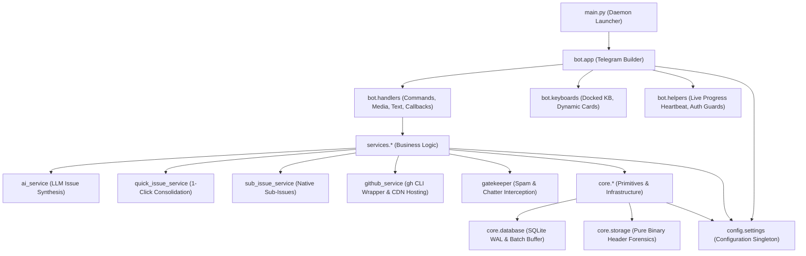

# Clean DAG Package Architecture

The `s-bros-bot` system follows a Directed Acyclic Graph (DAG) Clean Architecture pattern. Monolithic flat files and God-classes mixing database queries, Telegram UI, and GitHub API calls are strictly forbidden.

---

## Key Architectural Invariants

1. **Debounced Media Album Buffer**:
   Telegram delivers multi-photo uploads as individual messages sharing a `media_group_id`. The bot holds an asynchronous 2.0s debounce buffer to collect all items into a single staging batch card before responding.

2. **Direct Asset Hosting via `gh --attach`**:
   Screenshots are passed directly to `gh issue create ... --attach "<path>#<alt>"`. GitHub automatically uploads the image to its high-speed secure asset CDN and rewrites the Markdown image link.

3. **Concurrency Locks**:
   SQLite atomic transitions (`UPDATE batches SET status='processing' WHERE id=? AND status='open'`) guarantee that multi-clicks on inline buttons never publish duplicate GitHub issues.

4. **Continuous Live Progress Heartbeat**:
   The live progress ticker runs continuously with an elapsed timer (`⏱️ mm:ss`) and animated spinner (`⚡`, `🔄`, `⚙️`, `✨`), completely eliminating frozen UI illusions during long LLM audits.
